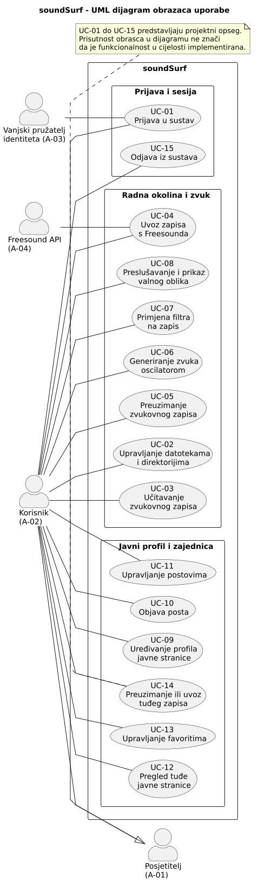

# 3. Obrasci uporabe

## 3.1 Dijagram obrazaca uporabe

UML dijagram obrazaca uporabe prikazuje granicu sustava soundSurf, relevantne aktere i petnaest obrazaca uporabe definiranih projektnim zahtjevima.

Obrasci uporabe grupirani su prema funkcionalnim cjelinama: prijava i sesija, radna okolina i obrada zvuka te javni profil i zajednica.

**Slika 3.1. UML dijagram obrazaca uporabe sustava soundSurf**

[Otvori dijagram u punoj veličini](./assets/diagrams/3-1-soundsurf-obrasci-uporabe.svg) | [PlantUML izvor](./puml/3-1-soundsurf-obrasci-uporabe.puml)

Dijagram prikazuje ukupni projektni opseg. Prisutnost obrasca uporabe ne podrazumijeva da je pripadajuća funkcionalnost u cijelosti implementirana. Detaljne specifikacije svih obrazaca nalaze se u odjeljku 3.2.

### Akteri

| ID | Naziv | Vrsta | Generalizacija |
| --- | --- | --- | --- |
| A-01 | Posjetitelj | Primarni akter pri prijavi. | Opći (bazni) akter. |
| A-02 | Korisnik | Primarni akter pri korištenju aplikacije. | Specijalizacija aktera Posjetitelj. |
| A-03 | Vanjski pružatelj identiteta (OAuth 2.0 / OIDC) | Sekundarni akter pri prijavi. | — |
| A-04 | Freesound API | Sekundarni akter pri uvozu zapisa. | — |

Korisnik je specijalizacija aktera Posjetitelj. Uloge vlasnika radne okoline, autora javne stranice i posjetitelja tuđe stranice predstavljaju različite načine korištenja sustava, a ne zasebne aktere.

### Popis obrazaca uporabe

| ID | Naziv | Aktivni akter | Pasivni akteri | Odnosi | Povezani zahtjevi |
| --- | --- | --- | --- | --- | --- |
| UC-01 | Prijava u sustav | Posjetitelj | Vanjski pružatelj identiteta | — | F-01, F-02 |
| UC-02 | Upravljanje datotekama i direktorijima | Korisnik | — | — | F-07, F-08, F-09, F-10, F-11 |
| UC-03 | Učitavanje zvukovnog zapisa | Korisnik | — | — | F-04 |
| UC-04 | Uvoz zapisa s Freesounda | Korisnik | Freesound API | — | F-05 |
| UC-05 | Preuzimanje zvukovnog zapisa | Korisnik | — | — | F-06 |
| UC-06 | Generiranje zvukovnog zapisa oscilatorom | Korisnik | — | — | F-12, F-13 |
| UC-07 | Primjena filtra na zapis | Korisnik | — | — | F-14, F-15 |
| UC-08 | Preslušavanje zapisa i prikaz valnog oblika | Korisnik | — | — | F-16, F-17 |
| UC-09 | Uređivanje profila javne stranice | Korisnik | — | — | F-18 |
| UC-10 | Objava posta | Korisnik | — | — | F-19 |
| UC-11 | Upravljanje postovima | Korisnik | — | — | F-20, F-21, F-22 |
| UC-12 | Pregled tuđe javne stranice | Korisnik | — | — | F-23 |
| UC-13 | Upravljanje favoritima | Korisnik | — | — | F-24, F-25, F-26, F-27 |
| UC-14 | Preuzimanje ili uvoz tuđeg zapisa | Korisnik | — | — | F-28, F-29 |
| UC-15 | Odjava iz sustava | Korisnik | — | — | F-03 |

Tablica povezuje obrasce uporabe s funkcijskim zahtjevima F-01 do F-29 iz dokumenta [2. Analiza zahtjeva](2-Analiza-zahtjeva.md).

### Ovisnosti i logički slijed obrazaca uporabe

Obrasci uporabe nisu nužno međusobno neovisni. Za neke su potrebni rezultati prethodnih radnji, primjerice postojeći zvukovni zapis, objavljen post ili aktivna korisnička sesija. Isti preduvjet često se može ispuniti na više načina.

Tablica prikazuje funkcionalne ovisnosti svih petnaest obrazaca uporabe, bez nametanja obveznog redoslijeda ondje gdje ga zahtjevi ne propisuju.

| Obrazac uporabe | Nužni preduvjet | Povezanost s ostalim obrascima uporabe |
| --- | --- | --- |
| UC-01 – Prijava | Posjetitelj nije prijavljen. | Uspješna prijava uspostavlja sesiju potrebnu za UC-02 do UC-15. To je zajednički preduvjet, a ne UML odnos `include`. |
| UC-02 – Upravljanje datotekama | Aktivna sesija i dostupna radna okolina. | Upravlja stavkama nastalima kroz UC-03, UC-04, UC-06, UC-07 ili uvozom u UC-14. Korisnik može upravljati i ranije postojećim datotekama. |
| UC-03 – Učitavanje zapisa | Aktivna sesija i radna okolina. | Stvara zapis koji se kasnije može koristiti u UC-02, UC-05, UC-07, UC-08 i UC-10. |
| UC-04 – Uvoz s Freesounda | Aktivna sesija, radna okolina i dostupan Freesound API. | Alternativni način pribavljanja zapisa u odnosu na UC-03 i UC-06. Nakon uspješnog uvoza mogući su UC-02, UC-05, UC-07, UC-08 i UC-10. |
| UC-05 – Preuzimanje zapisa | Postojeći zvukovni zapis u vlastitoj radnoj okolini. | Zapis može biti početni, učitan kroz UC-03, uvezen kroz UC-04 ili UC-14, generiran kroz UC-06 ili spremljen nakon UC-07. Nije obvezni nastavak nijednog od tih UC-ova. |
| UC-06 – Generiranje zvuka | Aktivna sesija i radna okolina. | Generira novu datoteku za daljnje korištenje kroz UC-02, UC-05, UC-07, UC-08 ili UC-10. |
| UC-07 – Primjena filtra | Postojeći zvukovni zapis u vlastitoj radnoj okolini. | Obrađuje zapis koji već postoji, neovisno o njegovu porijeklu. Spremljeni rezultat može se koristiti u UC-02, UC-05, UC-08 i UC-10 ili ponovno obraditi. |
| UC-08 – Preslušavanje zapisa | Postojeći zvukovni zapis u vlastitoj radnoj okolini. | Može se izvršiti prije ili nakon UC-07 te nad zapisima iz različitih izvora. Prikaz rezultata u UC-07 ne znači obvezno izvođenje cijelog UC-08. |
| UC-09 – Uređivanje profila | Aktivna sesija. | Promjene podataka profila mogu biti vidljive drugim korisnicima u UC-12. Uređivanje profila nije obvezan preduvjet za UC-10. |
| UC-10 – Objava posta | Aktivna sesija i barem jedan zvukovni zapis u vlastitoj radnoj okolini. | Zapis može potjecati iz početnih datoteka, UC-03, UC-04, UC-06, UC-07 ili uvoznog ishoda UC-14. Uspješna objava stvara post kojim se upravlja kroz UC-11. Ako je post javan, može biti dostupan drugim korisnicima u UC-12, UC-13 i UC-14. |
| UC-11 – Upravljanje postovima | Postoji vlastiti post. | Upravlja postom nastalim kroz UC-10, uključujući ranije objavljene postove. Promjena vidljivosti ili brisanje utječe na dostupnost u UC-12, UC-13 i UC-14. |
| UC-12 – Pregled tuđe stranice | Aktivna sesija i postojeća tuđa javna stranica. | Omogućuje pregled dostupnih javnih postova. Korisnik može opcionalno pokrenuti UC-13 ili UC-14, ali pregled ne zahtijeva njihovo izvođenje. |
| UC-13 – Upravljanje favoritima | Aktivna sesija; za dodavanje je potrebna dostupna tuđa javna stranica ili post. | Dodavanje favorita može slijediti pregled u UC-12. Pregled ili uklanjanje ranije spremljenih favorita ne zahtijeva ponovno izvođenje UC-12 u istoj sesiji. |
| UC-14 – Preuzimanje ili uvoz tuđeg zapisa | Aktivna sesija i dostupan tuđi javni post sa zvukovnim zapisom. | Opcionalna radnja tijekom UC-12. Preuzimanje daje lokalnu datoteku, a uvoz stvara kopiju u radnoj okolini za mogući UC-02, UC-05, UC-07, UC-08 ili UC-10. |
| UC-15 – Odjava | Aktivna sesija. | Završava sesiju potrebnu za zaštićene funkcionalnosti. Za njihovo ponovno korištenje potrebno je ponovno izvršiti UC-01. |

**Tumačenje ovisnosti:** Navedene veze uglavnom predstavljaju preduvjete, moguće nastavke rada ili ovisnosti o podacima. Ne predstavljaju automatski UML odnose `include` ili `extend`.

**Više izvora zvuka:** Zapis potreban za UC-05, UC-07, UC-08 i UC-10 može već postojati u radnoj okolini, primjerice kao početni zapis. Stoga UC-03, UC-04 ili UC-06 ne moraju biti izvršeni prije svake od tih funkcionalnosti.

**Formalna veza:** UC-14 može proširiti UC-12 odnosom `extend` kada korisnik tijekom pregledavanja tuđeg javnog sadržaja pokrene preuzimanje ili uvoz zapisa. Ostale navedene mogućnosti nastavka rada nisu same po sebi UML odnosi proširenja.

**Razlika između UC-04 i UC-05:** UC-04 uvozi zapis s vanjske usluge u radnu okolinu, dok UC-05 preuzima zapis iz radne okoline na korisnikovo računalo. Te radnje nisu međusobno obvezne.

**Napomena o UC-07 i UC-08:** Prikaz valnog oblika obrađenog rezultata u UC-07 sadržajno je povezan s UC-08, ali ne zahtijeva izvođenje cijelog zasebnog obrasca preslušavanja.

## 3.2 Specifikacije obrazaca uporabe

### UC-01: Prijava u sustav

| Element specifikacije | Opis |
| --- | --- |
| Primarni akter | Posjetitelj (A-01); nakon uspješne prijave djeluje kao Korisnik (A-02) |
| Sekundarni akter | Vanjski pružatelj identiteta (A-03) |
| Povezani zahtjevi | F-01, F-02 |
| Preduvjeti | Posjetitelj nije prijavljen u aplikaciju. |
| Glavni uspješni tok | 1. Posjetitelj odabire prijavu u aplikaciji. 2. Aplikacija ga preusmjerava na vanjskog pružatelja identiteta. 3. Posjetitelj potvrđuje svoj identitet kod pružatelja identiteta (OAuth 2.0 / OIDC). 4. Pružatelj identiteta vraća aplikaciji potvrdu identiteta. 5. Ako je to prva prijava korisnika, aplikacija stvara korisnički račun i radnu okolinu s tri početna zvukovna zapisa (F-02). 6. Aplikacija otvara sesiju; Posjetitelj postaje Korisnik i ima pristup svojoj radnoj okolini i javnoj stranici. |
| Alternativni tokovi i iznimke | 3a — Posjetitelj odustane od prijave: pružatelj identiteta ne vrati potvrdu; aplikacija ostaje u neprijavljenom stanju. 4a — Pružatelj identiteta vrati pogrešku: aplikacija prikazuje obavijest da prijava nije uspjela i nudi ponovni pokušaj; sesija se ne otvara. 6a — Otvaranje korisničke sesije nije uspjelo: aplikacija ne dopušta pristup radnoj okolini i prikazuje obavijest o neuspjehu. |
| Posljedice | Korisnik ima otvorenu sesiju i pristup svojoj radnoj okolini i javnoj stranici; pri prvoj prijavi postoji i novostvoren račun s tri početna zapisa. |

### UC-02: Upravljanje datotekama i direktorijima

| Element specifikacije | Opis |
| --- | --- |
| Primarni akter | Korisnik (A-02) |
| Povezani zahtjevi | F-07, F-08, F-09, F-10, F-11 |
| Preduvjeti | Korisnik je prijavljen i ima otvorenu radnu okolinu. |
| Glavni uspješni tok | 1. Korisnik otvara svoju radnu okolinu i pregledava stablo direktorija i datoteka. 2. Korisnik odabire radnju: stvaranje direktorija, preimenovanje, premještanje datoteke ili brisanje datoteke odnosno direktorija. 3. Korisnik unosi potrebne podatke i potvrđuje odabranu radnju. 4. Aplikacija izvršava radnju i prikazuje ažuriranu strukturu. |
| Alternativni tokovi i iznimke | 3a — Direktorij ili datoteka s odabranim nazivom već postoji na istoj razini: aplikacija odbija stvaranje ili preimenovanje uz objašnjenje. 4a — Izvršavanje radnje nije uspjelo: aplikacija prikazuje obavijest i ne prikazuje neuspjelu promjenu kao uspješnu. |
| Posljedice | Struktura direktorija i datoteka radne okoline odražava izvedenu radnju. |

### UC-03: Učitavanje zvukovnog zapisa

| Element specifikacije | Opis |
| --- | --- |
| Primarni akter | Korisnik (A-02) |
| Povezani zahtjevi | F-04 |
| Preduvjeti | Korisnik je prijavljen i ima otvorenu radnu okolinu. |
| Glavni uspješni tok | 1. Korisnik odabire direktorij u radnoj okolini u koji želi učitati zapis. 2. Korisnik odabire lokalnu datoteku u formatu WAV, MP3 ili FLAC i pokreće učitavanje. 3. Aplikacija provjerava format i veličinu datoteke (NF-01). 4. Aplikacija pohranjuje datoteku u odabrani direktorij radne okoline. 5. Aplikacija prikazuje novu datoteku na popisu sadržaja direktorija. |
| Alternativni tokovi i iznimke | 3a — Nepodržan format: aplikacija odbija datoteku i objašnjava koji su formati podržani; datoteka se ne pohranjuje. 3b — Datoteka prevelika: aplikacija odbija datoteku uz objašnjenje najveće dopuštene veličine (NF-01); datoteka se ne pohranjuje. 3c — Naziv datoteke već postoji u odabranom direktoriju: aplikacija traži novi naziv ili potvrdu prepisivanja prije pohrane. 4a — Pohrana nije uspjela: aplikacija prijavljuje neuspjeh i ne prikazuje lažnu potvrdu uspješnog učitavanja. |
| Posljedice | Nova zvukovna datoteka dostupna je u odabranom direktoriju radne okoline i spremna za preslušavanje i obradu. |

### UC-04: Uvoz zapisa s Freesounda

| Element specifikacije | Opis |
| --- | --- |
| Primarni akter | Korisnik (A-02) |
| Sekundarni akter | Freesound API (A-04) |
| Povezani zahtjevi | F-05 |
| Preduvjeti | Korisnik je prijavljen i ima otvorenu radnu okolinu. |
| Glavni uspješni tok | 1. Korisnik u radnoj okolini pokreće pretraživanje Freesounda. 2. Korisnik unosi pojam za pretraživanje. 3. Aplikacija dohvaća i prikazuje rezultate preko Freesound API-ja. 4. Korisnik odabire zapis i odredišni direktorij. 5. Aplikacija uvozi zapis i prikazuje ga u odabranom direktoriju. |
| Alternativni tokovi i iznimke | 3a — Freesound API nije dostupan ili odbije zahtjev: aplikacija prikazuje obavijest i ne pohranjuje zapis. 5a — Uvoz nije uspio: aplikacija prikazuje obavijest o neuspjehu. |
| Posljedice | Odabrani zvukovni zapis dostupan je u radnoj okolini korisnika. |

### UC-05: Preuzimanje zvukovnog zapisa

| Element specifikacije | Opis |
| --- | --- |
| Primarni akter | Korisnik (A-02) |
| Povezani zahtjevi | F-06 |
| Preduvjeti | Zvukovni zapis postoji u radnoj okolini korisnika. |
| Glavni uspješni tok | 1. Korisnik u radnoj okolini odabire zvukovni zapis. 2. Korisnik odabire format preuzimanja: WAV, MP3 ili FLAC. 3. Aplikacija priprema zapis u odabranom formatu. 4. Korisnik preuzima pripremljenu datoteku. |
| Alternativni tokovi i iznimke | 2a — Odabrani format nije moguće pripremiti: aplikacija obavještava korisnika o neuspjehu; preuzimanje se ne pokreće. |
| Posljedice | Korisnik na svom računalu ima datoteku koja sadržajno odgovara zapisu iz radne okoline u odabranom formatu. |

### UC-06: Generiranje zvukovnog zapisa oscilatorom

| Element specifikacije | Opis |
| --- | --- |
| Primarni akter | Korisnik (A-02) |
| Povezani zahtjevi | F-12, F-13 |
| Preduvjeti | Korisnik je prijavljen i ima otvorenu radnu okolinu. |
| Glavni uspješni tok | 1. Korisnik u radnoj okolini odabire generiranje novog zvukovnog zapisa. 2. Korisnik odabire oblik vala oscilatora (sinus, kvadrat, pila ili trokut) te zadaje frekvenciju, trajanje i amplitudu. 3. Korisnik odabire odredišni direktorij, upisuje naziv datoteke i potvrđuje generiranje. 4. Aplikacija provjerava parametre i generira zvukovni zapis. 5. Aplikacija pohranjuje novu datoteku u odabrani direktorij. |
| Alternativni tokovi i iznimke | 4a — Parametar nije valjan (primjerice, negativno trajanje): aplikacija odbija unos uz objašnjenje i ne generira zapis. 5a — Datoteka s istim nazivom već postoji u direktoriju: aplikacija traži drugi naziv. 5b — Pohrana nije uspjela: aplikacija prijavljuje neuspjeh i ne prikazuje lažnu potvrdu. |
| Posljedice | Nova generirana datoteka dostupna je u odabranom direktoriju radne okoline. |

### UC-07: Primjena filtra na zapis

| Element specifikacije | Opis |
| --- | --- |
| Primarni akter | Korisnik (A-02) |
| Povezani zahtjevi | F-14, F-15 |
| Preduvjeti | Odabrani zvukovni zapis postoji u radnoj okolini korisnika. |
| Glavni uspješni tok | 1. Korisnik odabire zvukovni zapis i vrstu filtra kao parametar (F-14): niskopropusni ili visokopropusni (granična frekvencija), pojačanje (faktor pojačanja), reverb (vrijeme odziva i udio efekta) ili tremolo (brzina i dubina modulacije). 2. Korisnik zadaje parametre odabrane vrste filtra. 3. Aplikacija provjerava jesu li parametri unutar dopuštenog raspona (prema pravilima provjere unosa). 4. Korisnik pokreće primjenu filtra. 5. Aplikacija obrađuje zapis i prikazuje rezultat, uključujući valni oblik (UC-08), prije konačne pohrane. 6. Korisnik bira hoće li rezultat spremiti kao novu datoteku ili prepisati izvornu (F-15). 7. Aplikacija pohranjuje rezultat prema odabiru iz koraka 6. |
| Alternativni tokovi i iznimke | 3a — Parametar izvan dopuštenog raspona: aplikacija odbija vrijednost ili je ograničava na rub dopuštenog raspona i traži ispravak prije nastavka na korak 4. 5a — Obrada nije uspjela: aplikacija prijavljuje neuspjeh, izvorna datoteka ostaje nepromijenjena i rezultat se ne pohranjuje. 6a — Korisnik odustane prije pohrane: izvorna datoteka ostaje nepromijenjena; obrađeni rezultat se ne pohranjuje. |
| Posljedice | U radnoj okolini postoji obrađeni zapis — kao nova datoteka ili kao zamjena izvorne, prema odabiru korisnika u koraku 6. |

### UC-08: Preslušavanje zapisa i prikaz valnog oblika

| Element specifikacije | Opis |
| --- | --- |
| Primarni akter | Korisnik (A-02) |
| Povezani zahtjevi | F-16, F-17 |
| Preduvjeti | Zvukovni zapis postoji u radnoj okolini korisnika. |
| Glavni uspješni tok | 1. Korisnik odabire zvukovni zapis u svojoj radnoj okolini. 2. Aplikacija prikazuje valni oblik zapisa u vremenskoj domeni. 3. Korisnik pokreće reprodukciju te po potrebi pauzira ili mijenja položaj reprodukcije. 4. Aplikacija reproducira zvuk i prikazuje trenutačni položaj na valnom obliku. |
| Alternativni tokovi i iznimke | 2a — Prikaz ili reprodukcija nisu dostupni: aplikacija prikazuje obavijest o pogrešci. |
| Posljedice | Korisnik može preslušati zapis uz prikaz njegova valnog oblika. |

### UC-09: Uređivanje profila javne stranice

| Element specifikacije | Opis |
| --- | --- |
| Primarni akter | Korisnik (A-02) |
| Povezani zahtjevi | F-18 |
| Preduvjeti | Korisnik je prijavljen. |
| Glavni uspješni tok | 1. Korisnik otvara uređivanje podataka svoje javne stranice. 2. Korisnik mijenja korisničko ime, profilnu sliku ili kratki opis. 3. Korisnik potvrđuje spremanje promjena. 4. Aplikacija pohranjuje izmjene i prikazuje ažurirane podatke. |
| Alternativni tokovi i iznimke | 3a — Spremanje izmjena nije uspjelo: aplikacija prikazuje obavijest, a prethodno spremljeni podaci ostaju nepromijenjeni. |
| Posljedice | Javna stranica korisnika prikazuje ažurirane podatke profila. |

### UC-10: Objava posta

| Element specifikacije | Opis |
| --- | --- |
| Primarni akter | Korisnik (A-02) |
| Povezani zahtjevi | F-19 |
| Preduvjeti | Korisnik je prijavljen i u svojoj radnoj okolini ima barem jedan zvukovni zapis. |
| Glavni uspješni tok | 1. Korisnik na svojoj javnoj stranici pokreće objavu novog posta. 2. Korisnik odabire zvukovni zapis iz radne okoline koji želi objaviti. 3. Korisnik unosi tekstualni opis posta i odabire je li post javan ili privatan (F-21). 4. Korisnik potvrđuje objavu. 5. Aplikacija pohranjuje post i prikazuje ga na javnoj stranici korisnika prema odabranoj vidljivosti. |
| Alternativni tokovi i iznimke | 2a — Radna okolina je prazna: aplikacija objašnjava da je potreban barem jedan zvukovni zapis prije objave i upućuje korisnika na uvoz ili generiranje zapisa (UC-03/UC-04/UC-06). 3a — Tekstualni opis nije unesen: aplikacija traži unos tekstualnog opisa prije nastavka objave. 5a — Pohrana nije uspjela: aplikacija prijavljuje neuspjeh i ne prikazuje lažnu potvrdu objave; post se ne prikazuje na javnoj stranici. |
| Posljedice | Novi post postoji na javnoj stranici korisnika, vidljiv ovisno o odabranoj postavci javnosti. |

### UC-11: Upravljanje postovima

| Element specifikacije | Opis |
| --- | --- |
| Primarni akter | Korisnik (A-02) |
| Povezani zahtjevi | F-20, F-21, F-22 |
| Preduvjeti | Post postoji na javnoj stranici korisnika. |
| Glavni uspješni tok | 1. Korisnik otvara vlastiti postojeći post. 2. Korisnik odabire uređivanje opisa, promjenu vidljivosti ili brisanje posta. 3. Korisnik unosi promjenu odnosno potvrđuje brisanje. 4. Aplikacija sprema promjenu ili briše post te ažurira njegov prikaz. |
| Alternativni tokovi i iznimke | 3a — Korisnik odustane od promjene ili brisanja: post ostaje nepromijenjen. 4a — Spremanje nije uspjelo: aplikacija prikazuje obavijest i ne potvrđuje uspješnu promjenu. |
| Posljedice | Post je izmijenjen, promijenjene vidljivosti ili obrisan, prema odabranoj radnji. |

### UC-12: Pregled tuđe javne stranice

| Element specifikacije | Opis |
| --- | --- |
| Primarni akter | Korisnik (A-02) |
| Povezani zahtjevi | F-23 |
| Preduvjeti | Korisnik je prijavljen; tuđa javna stranica postoji. |
| Glavni uspješni tok | 1. Korisnik otvara javnu stranicu drugog korisnika. 2. Aplikacija prikazuje korisničko ime, profilnu sliku i opis vlasnika stranice. 3. Aplikacija prikazuje samo postove označene kao javne. 4. Korisnik pregledava dostupne postove. |
| Alternativni tokovi i iznimke | 3a — Stranica nema javnih postova: aplikacija prikazuje prazan popis uz odgovarajuću poruku. |
| Točka proširenja | Nakon prikaza javnih postova, korisnik može odabrati zvukovni zapis i pokrenuti UC-14 za njegovo preuzimanje ili uvoz. |
| Posljedice | Korisnik je vidio profil i javne postove drugog korisnika. |

### UC-13: Upravljanje favoritima

| Element specifikacije | Opis |
| --- | --- |
| Primarni akter | Korisnik (A-02) |
| Povezani zahtjevi | F-24, F-25, F-26, F-27 |
| Preduvjeti | Korisnik je prijavljen. Za dodavanje favorita potrebna je dostupna tuđa javna stranica ili javni post. Za uklanjanje mora postojati spremljeni favorit. Pregled popisa favorita moguć je i kada je popis prazan. |
| Glavni uspješni tok | 1. Korisnik otvara tuđu javnu stranicu ili javni post odnosno svoj popis favorita. 2. Korisnik odabire dodavanje stranice ili posta u favorite ili uklanjanje postojeće stavke. 3. Aplikacija ažurira popis favorita. 4. Korisnik može pregledati ažurirani popis favorita. |
| Alternativni tokovi i iznimke | 2a — Stavka više nije javno dostupna: aplikacija ne dopušta dodavanje nedostupnog posta u favorite. |
| Posljedice | Popis favorita korisnika odražava izvedenu radnju. |

### UC-14: Preuzimanje ili uvoz tuđeg zapisa

| Element specifikacije | Opis |
| --- | --- |
| Primarni akter | Korisnik (A-02) |
| Povezani zahtjevi | F-28, F-29 |
| Preduvjeti | Tuđi javni post sa zvukovnim zapisom dostupan je (UC-12). |
| Glavni uspješni tok | 1. Korisnik odabire preuzimanje zapisa s tuđeg posta na svoje računalo. 2. Aplikacija isporučuje datoteku korisniku za preuzimanje. |
| Alternativni tokovi i iznimke | 1a — Dodavanje zapisa u radnu okolinu: korisnik umjesto preuzimanja odabire dodavanje zapisa u vlastitu radnu okolinu. Aplikacija pohranjuje kopiju zapisa u odabrani direktorij korisnika (F-29). |
| Posljedice | Korisnik ima lokalnu kopiju zapisa ili je zapis dodan u njegovu radnu okolinu, prema odabranoj radnji. |

### UC-15: Odjava iz sustava

| Element specifikacije | Opis |
| --- | --- |
| Primarni akter | Korisnik (A-02) |
| Povezani zahtjevi | F-03 |
| Preduvjeti | Korisnik je prijavljen u aplikaciju. |
| Glavni uspješni tok | 1. Korisnik odabire odjavu.  2. Aplikacija završava korisničku sesiju.  3. Aplikacija preusmjerava osobu na neprijavljeni prikaz.  4. Pristup radnjama rezerviranima za prijavljene korisnike više nije dopušten bez nove prijave. |
| Alternativni tokovi i iznimke | 2a — Sesija je već istekla: aplikacija prikazuje neprijavljeni prikaz i ne dopušta pristup zaštićenim sadržajima. |
| Posljedice | Sesija više nije aktivna; osoba djeluje kao Posjetitelj. |

## Napomena o mogućem proširenju

Generiranje zvuka moglo bi se proširiti odabirom sintetiziranog instrumenta, umjesto oscilatora ili uz njega, te eventualno sučeljem za sviranje nota. Službeni opis zadatka navodi oscilator i instrument kao primjere načina generiranja zvuka. Postojeći zahtjevi F-12 i F-13, koji obuhvaćaju generiranje zvuka oscilatorom, već zadovoljavaju minimalni zahtjev. Stoga je mogućnost odabira instrumenta i sviranja nota prijedlog dodatne funkcionalnosti, a ne obveza za trenutačni opseg projekta.
